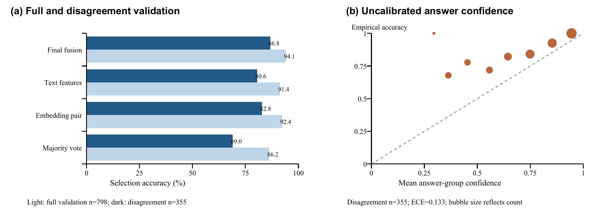

# Compact Evidence Fusion for Reliable LLM Candidate Selection

DASE7506 Advanced Machine Learning Methods - Mini-project 2

## Abstract

We study whether comparing candidate solutions improves selection of a correct
final numeric answer under a 16 MiB inference-asset and 30-second CPU budget.
The selector combines a shared linear embedding scorer, a five-seed relative-
embedding MLP ensemble, and shallow boosted trees on candidate features.
Component scores are separately normalized and mixed after masking unparseable
final answers. The frozen method achieves 384/467 (82.23%) on the complete test
bank, compared with 323/467 (69.16%) for final-answer majority voting. It uses
5.127 MiB of extra assets; complete local test prediction plus independent
scoring takes 2.150-2.187 seconds across three fresh runs. Validation ablations
support modest benefits from explicit consensus features, while a limited
arithmetic matcher does not help. Confidence helps order errors but does not
establish calibrated reasoning reliability.

## 1. Research question and task

**Can comparing four candidate solutions improve selection beyond judging each
candidate independently?** Our hypothesis is that agreement and relative
candidate information complement learned plausibility evidence, while majority
agreement alone can amplify shared mistakes. A second hypothesis is that local
arithmetic consistency helps distinguish convincing wrong solutions. We
examine both using implemented controls and feature ablations.

The program returns exactly one index in 0..3 per question. The unchanged
official scorer compares that candidate's final numeric answer with the
reference, including equivalent fractions and decimals. Several candidates may
be correct. Correct selection is not proof that every reasoning step is valid;
this distinction governs our interpretation of all experimental evidence.

## 2. Data and development protocol

The supplied GSM8K-derived bank contains 4,755 training, 798 validation and 467
test questions, with four candidate texts and fixed float32 representations of
shape [N, 4, 1024] prepared with Qwen3-0.6B. The splits do not overlap. Each
question has at least one candidate with a correct final answer. Fitting,
normalization and tree-threshold quantiles use training only. Validation guides
checkpoint and method selection. Test references are reserved for the frozen
method's final scoring and reproduction. There are no external data,
additional pretrained weights, online LLM calls or question-ID answer lookups.

Bank construction matters: training and validation include easier groups,
whereas test questions have at least two distinct valid parsed final answers.
We define **hard validation** by that same input-only rule: at least two
distinct non-None outputs of the official parser. It contains 355 of 798
questions; 443 form the complementary easier subset. Majority voting is
correct on all 443 easier questions. Thus mixed full-validation accuracy alone
hides much of the remaining difficulty. A validation-to-test gap also reflects
this construction shift and cannot by itself identify overfitting.

Training observations motivate controls. Of 4,755 training groups, 2,242 have
four correct candidates. Candidate positions have similar correctness rates
(75.04%-75.79%). Correct candidates average 464.8 characters versus 527.4 for
incorrect candidates, but the shortest-answer control performs poorly.
Correlations in presentation are diagnostics, not evidence that length is a
sound substitute for interpreting the problem.

## 3. Models and selection procedure

### 3.1 Training-free controls

The first-candidate control returns index 0. Majority voting groups the
official parsed numeric answers, gives invalid answers zero votes, and selects
the first member of the largest group. Majority-shortest uses length to break
voting ties; shortest ignores votes. These controls expose the value of
agreement and the weakness of a simple style heuristic.

### 3.2 Shared embedding scorers

The linear model shares one scorer across 1024-dimensional candidate vectors.
The nonlinear model concatenates each vector with its difference from the
within-question mean, yielding 2048 features, and uses one 128-unit ReLU hidden
layer. It is trained on hard training groups. Both standardize using training-
only means and scales, with a minimum scale of 0.05.

The objective is negative log softmax probability mass on the set of correct
candidates, plus 0.25 times candidate-level binary cross entropy. A positive-set
loss avoids arbitrarily designating only one correct candidate as positive.
Adam uses batches of 128, at most 70 epochs and patience 12. The linear scorer
uses seed 17, learning rate 0.002 and L2 0.001, retaining epoch 31. The MLP uses
learning rate 0.001, L2 0.005 and dropout 0.3. Its initial seed 29 retains epoch
16; subsequent seeds are 31, 37, 41 and 43. All five predeclared seeds are
retained equally, without choosing or discarding lucky seeds. Their raw logits
are averaged before the component softmax.

Validation selects checkpoints. Initial fits prioritize full-validation
accuracy; hard-trained MLPs prioritize hard-validation accuracy, then full
accuracy and positive-set loss. Neither gradients nor normalization fit
validation labels. Direct embedding rows in Table 1 use raw logits; fusion
additionally masks invalid parsed final answers.

### 3.3 Text and candidate-relative features

The text module constructs 96 raw features and their 96 within-question
centered counterparts. Groups cover length/format and lexical style, question
overlap, numeric-answer properties, simple arithmetic equalities and agreement
among candidate answers. It uses neither IDs nor cached predictions. Arithmetic
expressions use an AST whitelist of numeric constants and addition,
subtraction, multiplication and division; Python eval is not used.

A deterministic NumPy histogram gradient-boosting implementation learns scores
with listwise softmax cross entropy against a uniform target over correct
candidates. Quantile thresholds are fitted on training only. The common
ablation recipe is depth 3, 32 bins, learning rate 0.06, L2 10, minimum leaf
count 50, at most 140 trees and validation selection every 10 iterations.
Seed 2026 is recorded although these tree runs are deterministic. The retained
arithmetic-free model uses 180 features and 110 trees.

### 3.4 Frozen fusion

The linear scorer, mean MLP logits and text scores are converted separately to
masked softmax distributions at temperature 1. Invalid parsed final answers
are excluded before normalization. Their fixed mixture weights are 0.125,
0.125 and 0.75; the largest mixed candidate score is selected.

Two component combinations were initially searched. Each used the same
predeclared grid of text weights {0, 0.25, 0.5, 0.75, 1}, answer-group sum-pooling
weights {0, 0.5, 1} and explicit vote weights {0, 0.1, 0.25}: 45 configurations
per round, 90 total. Both selected zero extra pooling and zero extra votes.
The five-seed extension keeps those scalar settings unchanged. Zero added
pooling is not evidence that cross-candidate information is useless: the text
features and relative embeddings already contain it.

## 4. Validation comparisons and ablations

Table 1 uses root-run, unchanged official prediction and independent scoring.
Full validation contains 798 questions and hard validation 355. Complete time
sums fresh prediction-process and scoring-process wall times, including startup,
imports, loading, preprocessing and all members. Single-run development times
are local observations; the final row shows the range of three fresh runs.

| Method | Full accuracy (%) | Hard accuracy (%) | Complete time (s) | Assets (MiB) |
|---|---|---|---|---|
| First candidate | 78.20 | 54.93 | 0.836 | <0.001 |
| Shortest candidate | 69.30 | 37.75 | 0.822 | <0.001 |
| Majority + shortest tie | 84.46 | 65.07 | 0.854 | <0.001 |
| Final-answer majority | 86.22 | 69.01 | 0.848 | 0.000 |
| Linear embedding | 91.48 | 81.69 | 1.158 | 0.013 |
| Relative MLP, seed 29 | 90.85 | 82.54 | 0.953 | 1.018 |
| Text trees, full features | 90.85 | 79.44 | 2.770 | 0.016 |
| Text trees, no arithmetic | 91.35 | 80.56 | 2.594 | 0.022 |
| Text trees, no consensus | 90.10 | 77.75 | 2.673 | 0.027 |
| Masked embedding fusion | 92.36 | 82.82 | 0.993 | 1.032 |
| Mixed fusion, one MLP seed | 93.86 | 86.20 | 2.646 | 1.053 |
| Frozen fusion, five seeds | 94.11 | 86.76 | 3.122-3.226 | 5.127 |

The final model answers 751/798 validation and 308/355 hard questions correctly.
Relative to majority it gains 63 questions, or 7.89 full-validation percentage
points and 17.75 hard-subset points. Paired outcomes are 674 both correct, 77
only fusion correct, 14 only majority correct and 33 both wrong. A paired
bootstrap interval for the full-validation gain is [5.76, 10.28] percentage
points. It is conditional on the chosen model and reused validation bank, not
corrected for search and not an independent generalization guarantee.

The mixed model improves over its individual components, consistent with
complementary errors. Averaging all five predeclared MLP seeds adds two correct
validation questions over the single-seed mixture, at approximately 4.07 MiB
extra cost. This small gain is weak evidence of a broadly repeatable advantage;
we retain it as a fixed stability choice within the resource budget, not as
proof that larger ensembles are generally preferable.

The three text-tree variants use the same recipe and search budget. Early
stopping selects 80 trees for full features, 110 without arithmetic and 140
without consensus, with earliest checkpoint retained on ties. Removing
arithmetic gains four full-validation questions; removing consensus loses six
relative to full features. The former rejects the usefulness of this limited
arithmetic matcher here, not arithmetic verification generally. It misses
units, algebra, nested notation and the interpretation of a correct formula.
The latter supports a modest contribution from the explicit consensus group,
but other features retain indirect group information. It is not a pure
independent-candidate comparison, and selected capacity differs under the
shared stopping rule.

The shortest controls show that the training length correlation does not make
shorter answers reliably correct. They do not show that learned scorers are
free of style shortcuts. A question-plus-answer-only representation comparison
would be needed to isolate reasoning text: the supplied embeddings themselves
encode candidate traces.

Figure 1. Left: full-validation and input-defined hard-validation accuracy.
Right: hard-validation confidence-bin correctness versus mean selected-answer
probability mass. Confidence has not been calibrated. ECE is a descriptive
statistic on the same validation data used for model selection; it does not
establish out-of-sample calibration or reasoning validity.
## 5. Confidence and failure analysis

Diagnostic confidence is the mixed probability mass assigned to candidates
sharing the selected final answer; it is not automatically a calibrated
correctness probability. Ten-bin expected calibration error is 0.0591 and Brier
score 0.0578 on full validation, versus 0.1330 and 0.1298 on hard validation.
The easier groups inflate apparent reliability: 535 questions have confidence
at least 0.9, but only 92 are hard. Those 535 choices are all correct in this
validation sample, not a promise of error-free high-confidence predictions.

Ranking by confidence gives 200/200 correct at 25.06% coverage, 399/399 at
50%, and 594/599 (99.17%) at 75.06%, compared with 751/798 (94.11%) at full
coverage. These are retrospective diagnostics; the task requires an answer
for every question, so inference does not abstain. Reused validation data,
small low-confidence bins and easy-subset concentration limit calibration
and selective-prediction claims.

The saved validation errors illustrate semantic weaknesses. In the naps
question, three two-hour naps per week over 70 days should total 60 hours,
but a selected trace multiplies 3*2*70 to obtain 420. Every multiplication is
numerically correct; the missing step is conversion from days to weeks, and
both answers have two votes. In the stock question, a candidate returns gross
receipts of 100 instead of subtracting the original cost to reach profit 40.
In the student-pairing question, repeated answers can share an incorrect
counting interpretation. The candidate with final value 2 also contains
flawed intermediate statements about totals and pair counts. These examples
show why local arithmetic, consensus and fluent presentation do not establish
semantic correctness, and why an accepted final number need not imply a valid
explanation.

## 6. Frozen test result and resources

The release was frozen at 2026-10-22 08:11:43 UTC as mp2-751aa13c6e1c.
The freeze manifest records inference-source hashes and all matching asset
hashes and predeclares only the final selector and majority baseline for test
scoring. No method or setting is changed in response to test results.

| Frozen test method | Correct / questions | Accuracy (%) |
|---|---|---|
| Final-answer majority | 323 / 467 | 69.1649 |
| Final five-seed fusion | 384 / 467 | 82.2270 |

The test gain is 61 questions, or 13.0621 percentage points. All test groups
are hard by construction, so the appropriate difficulty-matched validation
comparison is 86.76% on hard validation versus 82.23% on test, rather than
94.11% on the mixed validation bank. Distribution differences and validation
selection optimism can both contribute; neither can be ruled out by these
figures. This evaluation concerns the published course bank, not arbitrary
mathematical reasoning.

The final bundle has 5,375,667 counted uncompressed bytes (5.127 MiB), including
six embedding checkpoints, one tree checkpoint and configuration. Prediction
plus independent scoring takes 2.1535, 2.1496 and 2.1866 seconds in three fresh
local test runs; validation takes 3.1977, 3.1220 and 3.2262 seconds. Timings
include startup, imports, assets/data loading, preprocessing and every member.
Eligibility is decided on the reference Xeon Platinum 8457C, not these local
measurements.

Development used CPU only, Python 3.12.14 and NumPy 2.5.3 on Windows 11 with
12 logical CPUs and 15.73 GiB RAM. The processor identifier is Intel64 Family 6
Model 154 Stepping 3, GenuineIntel. Training used one OpenBLAS/OpenMP/MKL
thread; official local inference configures four total threads. No GPU was used.

The recorded search comprised 18 embedding configurations, four centered-ridge
regularizers, five text configurations, 90 scalar fusion-grid settings and
one fixed five-seed comparison. Recorded cost sums are 77.577 seconds for
embedding training, 1.469 seconds for ridge fitting plus shared preprocessing,
195.214 seconds for text experiments, and 6.741 seconds for fusion search and
fixed rebuilding. These timers have different scopes; some text experiments
reuse deterministic input-only feature caches. They are not presented as an
exact total orchestration wall time. The tracked resource summary gives each
count and timing scope.

A fresh complete reconstruction of the frozen seven models and configuration,
including new text-feature extraction, took 80.315 seconds in the recorded
builder. All seven reconstructed weight files match the frozen SHA-256 hashes.
Independent reconstruction acceptance also confirms semantic configuration
equality and identical choices on all 798 validation questions.
The tracked evidence directory records the frozen recipe, seeds, selected checkpoints, exact
commands, external timings and asset hashes. Checkpoint scoring requires no
retraining. Root acceptance separately covers new IDs, different bank sizes,
singleton/reordered inputs, candidate permutation, input non-mutation and
inference reads limited to the checkpoint; these checks are not additional
training or test-guided model selection.

Quantitative sources are the tracked evidence/official records,
evidence/validation_analysis.json, evidence/resource_summary.json and
evidence/reproduction_acceptance.json in code.

## 7. Limitations and conclusion

Repeated validation-based architecture, checkpoint and mixture selection
introduces optimism. The reported bootstrap and confidence diagnostics do not
remove it; hard validation is also reused rather than an independent holdout.
Fixed references may not capture every ambiguity in natural-language questions.
Correctness here follows the official reference and parser, not an independent
audit of each derivation.

The evidence supports a compact combination of learned plausibility and
candidate-relative information for this bank. Explicit consensus features help
modestly under a controlled recipe; simple arithmetic matching does not.
The final offline fusion improves frozen-test accuracy while using about
5.13 MiB and a small local CPU budget. Its selections should still be understood
as estimates of final-answer correctness, not certificates of sound reasoning.

## 8. AI assistance and attribution

ChatGPT/Codex provided substantive multi-agent assistance with interpreting
requirements, implementing models and training, developing experimental tools,
analysing validation results and drafting this report and README. A coordinating
agent performs independent official evaluation and integration. The student is
responsible for reviewing and understanding the implementation and claims; this
must not be represented as unaided student work.

Questions and references derive from GSM8K under its retained MIT license.
Candidate solutions and fixed representations were prepared with Qwen3-0.6B.
No additional pretrained weights are used. The supplied license and attribution
files are retained; Python's standard library and NumPy support student code.

## References

[1] DASE7506 MP2 guide. https://github.com/xudongwu-0/DASE7506-MP2/blob/main/guide/GUIDE.md

[2] DASE7506 MP2 running instructions. https://github.com/xudongwu-0/DASE7506-MP2/blob/main/code/README.md

[3] GSM8K. https://github.com/openai/grade-school-math

[4] Qwen3-0.6B attribution. https://huggingface.co/Qwen/Qwen3-0.6B

